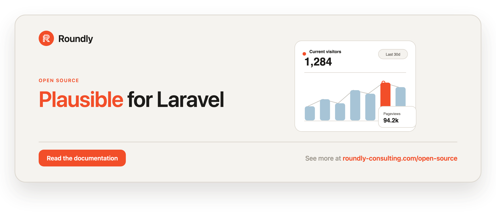

<!-- roundly-hero:start -->
<p align="center">
  <a href="https://roundly-consulting.com/open-source/docs/plausible-for-laravel?utm_source=github&utm_medium=readme&utm_campaign=open-source&utm_content=plausible-for-laravel">
    
  </a>
</p>
<!-- roundly-hero:end -->

# Plausible for Laravel

A clean, expressive client for the [Plausible Analytics](https://plausible.io) API. Query your
stats, capture custom events, and manage sites from your Laravel application using a fluent,
strongly-typed request API — no manual HTTP plumbing required.

## Requirements

- PHP `^8.4` with `ext-bcmath`
- Laravel `^12.0` or `^13.0`
- A Plausible account (Cloud or self-hosted) and an API key

## Integrates with

This package builds on four other roundly-consulting packages (hard `require`d — installed
automatically):

- **[package-toolkit-for-laravel](https://github.com/roundly-consulting/package-toolkit-for-laravel)**
  — the service provider is built on the toolkit's package builder, so the config/views/commands
  wiring and the publish tags are declared once. It also contributes a `php artisan about` section
  and backs the `Retry-After` hint on `RateLimitExceeded`. See [Rate limiting](#rate-limiting).
- **[enums-for-laravel](https://github.com/roundly-consulting/enums-for-laravel)** — the query
  enums (`Metric`, `Interval`, `GoalType`, `FilterOperator`, `Period`, `Dimension`, `Property`)
  gain the full `Helpers` surface: `values()`, `labels()`, `options()`, `toOptions()`,
  `validationRule()`, name/label lookups, and `is()`/`when*` helpers. See [Enums](#enums).
- **[http-client-rate-limits-for-laravel](https://github.com/roundly-consulting/http-client-rate-limits-for-laravel)**
  — every outbound surface (Stats, Events, Sites) is paced through a client-side rate limiter with
  server-authoritative adaptive backoff off Plausible's `429 Retry-After`. See
  [Rate limiting](#rate-limiting).
- **[money-for-laravel](https://github.com/roundly-consulting/money-for-laravel)** — event revenue
  is an exact `Money`: the amount reaches Plausible as a decimal string with no float anywhere on
  the way, and currencies Plausible can't convert are refused up front. See
  [Revenue](#revenue).

> While these packages are pre-Packagist they are wired by local path + private VCS in
> `composer.json`; nothing extra to install.

## Installation

Install the package via Composer:

```bash
composer require roundly-consulting/plausible-for-laravel
```

Optionally publish the config file:

```bash
php artisan vendor:publish --tag="plausible-config"
```

To customise the tracking-script Blade view, publish the views:

```bash
php artisan vendor:publish --tag="plausible-views"
```

## Configuration

The published config lives at `config/plausible.php`:

```php
<?php

declare(strict_types=1);

return [
    'url' => env('PLAUSIBLE_URL'),
    'key' => env('PLAUSIBLE_API_KEY'),
    'site' => env('PLAUSIBLE_SITE'),
    'timeout' => (int) env('PLAUSIBLE_TIMEOUT', 10),
    'retry' => [
        'times' => (int) env('PLAUSIBLE_RETRY_TIMES', 0),
        'sleep_ms' => (int) env('PLAUSIBLE_RETRY_SLEEP', 100),
    ],

    'rate_limits' => [
        'stats'  => [ /* enabled, owner, limit, per, adaptive, max_wait, jitter, per_site */ ],
        'events' => [ /* ... */ ],
        'sites'  => [ /* ... */ ],
    ],

    'tracking' => [
        'queue' => (bool) env('PLAUSIBLE_TRACKING_QUEUE', true),
        'user_agent' => env('PLAUSIBLE_TRACKING_USER_AGENT', 'PlausibleForLaravel'),
        'ip_address' => env('PLAUSIBLE_TRACKING_IP', '127.0.0.1'),
    ],

    'script' => [
        'domain' => env('PLAUSIBLE_SCRIPT_DOMAIN'),
        'src' => env('PLAUSIBLE_SCRIPT_SRC', 'https://plausible.io/js/script.js'),
    ],
];
```

| Key                     | Type      | Default                            | Env                          | Description |
|-------------------------|-----------|------------------------------------|------------------------------|-------------|
| `url`                   | `string`  | —                                  | `PLAUSIBLE_URL`              | Base URL of your Plausible instance, e.g. `https://plausible.io` (or your self-hosted domain). Required. |
| `key`                   | `string`  | —                                  | `PLAUSIBLE_API_KEY`          | Your Plausible API key, used as a Bearer token on Stats and Sites requests. Required. |
| `site`                  | `?string` | `null`                             | `PLAUSIBLE_SITE`             | Optional default site (domain). When set, fluent calls and the events helpers can omit the site. |
| `timeout`               | `int`     | `10`                               | `PLAUSIBLE_TIMEOUT`          | Per-request timeout in seconds. |
| `retry.times`           | `int`     | `0`                                | `PLAUSIBLE_RETRY_TIMES`      | Number of automatic retries on transient failures. `0` disables retries. |
| `retry.sleep_ms`        | `int`     | `100`                              | `PLAUSIBLE_RETRY_SLEEP`      | Milliseconds to wait between retries. |
| `rate_limits.*`         | `array`   | see [Rate limiting](#rate-limiting)| `PLAUSIBLE_*_RATELIMIT*`     | Per-surface client-side rate limiting for `stats`, `events`, and `sites`. |
| `tracking.queue`        | `bool`    | `true`                             | `PLAUSIBLE_TRACKING_QUEUE`   | Queue captures from the middleware / `Trackable` trait so they never block the response. |
| `tracking.user_agent`   | `string`  | `PlausibleForLaravel`              | `PLAUSIBLE_TRACKING_USER_AGENT` | User-agent used for server-side captures when no HTTP request is in scope. |
| `tracking.ip_address`   | `string`  | `127.0.0.1`                        | `PLAUSIBLE_TRACKING_IP`      | IP used for server-side captures when no HTTP request is in scope. |
| `script.domain`         | `?string` | `null`                             | `PLAUSIBLE_SCRIPT_DOMAIN`    | `data-domain` for the tracking script. Falls back to `site` when null. |
| `script.src`            | `string`  | `https://plausible.io/js/script.js`| `PLAUSIBLE_SCRIPT_SRC`       | URL of the hosted Plausible script (point at your self-hosted host or a script variant). |

Missing `url` or `key` throws `RoundlyConsulting\Plausible\Exceptions\MissingConfiguration`
(a `PlausibleException`) on the first call, rather than sending a broken request.

Set the essentials in your `.env`:

```dotenv
PLAUSIBLE_URL=https://plausible.io
PLAUSIBLE_API_KEY=your-api-key
PLAUSIBLE_SITE=my-site.com
```

### Where it shines

Built for backend platforms that track events server-side and read analytics back into their
own UI — marketing sites, client-zone / SaaS dashboards, and custom CRMs that want traffic and
conversion numbers inside their own admin instead of a separate tool.

## Usage

You can reach the client three ways — the `plausible()` helper, the `Plausible` facade, or by
resolving `RoundlyConsulting\Plausible\Plausible` from the container. All three return the same
instance and expose `stats()`, `events()`, and `sites()`.

```php
use RoundlyConsulting\Plausible\Facades\Plausible;

plausible()->stats();      // helper
Plausible::stats();        // facade
app(\RoundlyConsulting\Plausible\Plausible::class)->stats(); // container
```

### Stats API — fluent

The fluent builder is the recommended way to read stats. It returns typed result objects, so
you stop hand-parsing JSON, and accepts enums for type-safe metrics, periods, intervals and
properties (plain strings still work everywhere).

```php
use RoundlyConsulting\Plausible\Facades\Plausible;
use RoundlyConsulting\Plausible\Enums\Metric;
use RoundlyConsulting\Plausible\Enums\Period;
use RoundlyConsulting\Plausible\Enums\Property;

// Live visitors on the site right now
$live = Plausible::stats()->for('my-site.com')->realtime(); // int

// Aggregate metrics for a custom range, compared with the previous period
$result = Plausible::stats()
    ->for('my-site.com')                          // omit when PLAUSIBLE_SITE is set
    ->metrics(Metric::Visitors, Metric::Pageviews, Metric::BounceRate)
    ->between(now()->subDays(7), now())           // auto-sets period=custom
    ->compare()
    ->aggregate();                                // -> AggregateResult

$visitors = $result->metric(Metric::Visitors);    // typed int
$change   = $result->change(Metric::Visitors);    // comparison delta (or null)
$raw      = $result->response();                  // escape hatch to the Response

// Day-by-day trend you can chart
$points = Plausible::stats()
    ->for('my-site.com')
    ->metrics(Metric::Visitors)
    ->period(Period::ThirtyDays)
    ->timeseries()                                // -> TimeseriesResult
    ->points();                                   // list<TimeseriesPoint>

// Top traffic sources, ranked and paginated
$rows = Plausible::stats()
    ->for('my-site.com')
    ->metrics(Metric::Visitors)
    ->perPage(20)
    ->breakdown(Property::VisitSource)            // -> BreakdownResult
    ->rows();                                      // list<BreakdownRow>
```

`since(Carbon $start)` and `between(Carbon $start, Carbon $end)` both set `period=custom` for
you, so a date range can never be silently ignored.

#### Named period shortcuts

Skip the enum for the common ranges:

```php
Plausible::stats()->for('my-site.com')->today()->aggregate();
Plausible::stats()->for('my-site.com')->last7Days()->timeseries();
Plausible::stats()->for('my-site.com')->last30Days()->aggregate();
Plausible::stats()->for('my-site.com')->thisMonth()->aggregate();
Plausible::stats()->for('my-site.com')->lastMonth()->aggregate();   // custom range
Plausible::stats()->for('my-site.com')->thisYear()->aggregate();
// also: yesterday(), last6Months(), last12Months(), allTime()
```

#### Type-safe filters

Build Stats v2 filters fluently with `where()` / `orWhere()` (they target the `run()`
terminal). The raw `filter(string|array)` form still works for everything else.

```php
use RoundlyConsulting\Plausible\Enums\Dimension;
use RoundlyConsulting\Plausible\Enums\FilterOperator;

$result = Plausible::stats()
    ->for('my-site.com')
    ->metrics(Metric::Visitors)
    ->where(Dimension::VisitBrowser, FilterOperator::Is, 'Chrome')
    ->where('visit:os', 'is', ['Mac', 'Windows'])      // implicit AND, list value
    ->orWhere(Dimension::VisitCountry, FilterOperator::Is, 'US')  // OR with the previous
    ->run();
```

#### Caching

Cache any terminal call (`aggregate`/`timeseries`/`breakdown`/`run`/`realtime`) by a
deterministic signature of the query. Pass seconds or a `DateTimeInterface`, and optionally a
cache store:

```php
$result = Plausible::stats()
    ->for('my-site.com')
    ->metrics(Metric::Visitors)
    ->cache(300)                       // seconds; or ->cache(now()->addHour(), 'redis')
    ->aggregate();
```

#### Collections

Every result exposes `collect()` for an `Illuminate\Support\Collection` of typed rows
(`aggregate()` returns a metric-keyed collection of values):

```php
Plausible::stats()->for('my-site.com')->breakdown(Property::VisitSource)->collect();
Plausible::stats()->for('my-site.com')->timeseries()->collect();
Plausible::stats()->for('my-site.com')->aggregate()->collect();   // ['visitors' => 2001, ...]
```

#### Auto-paginating breakdowns

`cursor()` and `each()` transparently walk every page of a breakdown using PHP generators, so
you never write a page loop:

```php
foreach (Plausible::stats()->for('my-site.com')->cursor(Property::VisitSource) as $row) {
    // every row across every page
}

Plausible::stats()->for('my-site.com')->each(function ($row) {
    // return false to stop early
}, Property::VisitSource);
```

### Stats API — explicit requests

The request objects remain available for power users; the repository methods return the raw
`Illuminate\Http\Client\Response`, and a `*Result` variant returns the typed object.

```php
use RoundlyConsulting\Plausible\Requests\Stats\AggregateRequest;

$response = Plausible::stats()->aggregate(AggregateRequest::make(
    site: 'my-site.com',
    metrics: ['visitors', 'pageviews', 'bounce_rate'],
    compare: true,
));

$result = Plausible::stats()->aggregateResult(AggregateRequest::make(
    site: 'my-site.com',
    metrics: [Metric::Visitors],
)); // -> AggregateResult
```

`timeseriesResult()` and `breakdownResult()` exist too.

### Stats v2 query endpoint

The consolidated `/api/v2/query` endpoint unlocks dimensions, ordering, pagination and richer
metrics. Drive it from the same builder with `dimensions()`, `orderBy()`, `include()`, array
`filter()`s and a `run()` terminal:

```php
use RoundlyConsulting\Plausible\Enums\Dimension;
use RoundlyConsulting\Plausible\Enums\Metric;

$result = Plausible::stats()
    ->for('my-site.com')
    ->metrics(Metric::Visitors, Metric::BounceRate)
    ->dimensions(Dimension::EventPage)
    ->filter(['is', 'visit:browser', ['Chrome']])
    ->orderBy(['visitors', 'desc'])
    ->between(now()->subDays(7), now())
    ->perPage(10)
    ->run();                                       // -> QueryResult

foreach ($result->rows() as $row) {
    $row->dimension(0);   // e.g. "/pricing"
    $row->metric(0);      // visitors
}
```

Or build the request explicitly with `QueryRequest` and call `Plausible::stats()->runQuery($request)`.

> Stats v2 is available on Plausible Cloud and recent self-hosted versions. Older self-hosted
> instances may only expose the v1 endpoints above.

### Events API

Track conversions server-side — even where front-end JavaScript can't reach (API calls,
webhooks, queued jobs).

> Plausible needs the visitor's user-agent and IP to count unique visitors. Provide them with
> `setVisitor()` or `fromRequest()`; capturing without them throws
> `RoundlyConsulting\Plausible\Exceptions\UniqueVisitorIdentifierRequired`.

```php
use RoundlyConsulting\Plausible\Facades\Plausible;
use RoundlyConsulting\Plausible\Requests\Events\CaptureEventRequest;
use RoundlyConsulting\Plausible\DataTransferObjects\Revenue;

// Lift the visitor from the current request, send a pageview in one call
Plausible::events()->fromRequest(request())->pageview('https://my-site.com/blog/x');

// A custom revenue event, fired on the queue so it never blocks the response
Plausible::events()
    ->fromRequest(request())
    ->captureQueued(CaptureEventRequest::make(
        site: 'my-site.com',
        url: 'https://my-site.com/checkout',
        name: 'purchase',
        revenue: Revenue::of('49.00', 'EUR'),
        props: ['plan' => 'pro'],
    ));

// The explicit, synchronous form still works
Plausible::events()
    ->setVisitor(userAgent: request()->userAgent(), ipAddress: request()->ip())
    ->capture(CaptureEventRequest::make(
        site: 'my-site.com',
        url: 'https://my-site.com/blog/some-post',
        referrer: 'https://affiliate-site.com',
        props: ['author' => 'jane'],
    ));
```

`fromRequest()` and `pageview()` use the configured default site when none is given.
`captureQueued()` dispatches `RoundlyConsulting\Plausible\Jobs\CaptureEventJob` onto your queue.

#### Revenue

Revenue is a [money-for-laravel](https://github.com/roundly-consulting/money-for-laravel) `Money`,
so the amount is exact at any size and never passes through a float:

```php
use RoundlyConsulting\Money\Money;
use RoundlyConsulting\Plausible\DataTransferObjects\Revenue;

Revenue::of('49', 'eur');                       // {"currency":"EUR","amount":"49.00"}
Revenue::of('1500', 'JPY');                     // {"currency":"JPY","amount":"1500"}
Revenue::make(Money::ofMinor(1299, 'USD'));     // {"currency":"USD","amount":"12.99"}
Revenue::make($order->total);                   // any Money you already hold

Revenue::of('92233720368547758.08', 'USD');     // beyond int64 — sent exactly
```

- `of()` takes major units as a decimal **string** or an int — there is no float overload.
- The payload `amount` is the currency's decimal string (`toDecimal()`); Plausible accepts it
  as a string.
- Anything invalid throws `RoundlyConsulting\Plausible\Exceptions\InvalidRevenue` (the money
  exception is chained as `getPrevious()`):
  - an unknown or malformed currency code (`'EURO'`);
  - a **custom** (non-ISO 4217) currency such as loyalty points — Plausible converts ISO
    currencies only and would silently drop the revenue;
  - more decimals than the currency allows (`'12.999'` USD) — round it yourself with money
    first, revenue never rounds for you;
  - a malformed amount (`'1,50'`, `'1e3'`).

#### Batch capture

For bulk or historical imports, send many events at once — synchronously, or as a single
queued [batch](https://laravel.com/docs/queues#job-batching):

```php
$events = [
    CaptureEventRequest::make(site: 'my-site.com', url: 'https://my-site.com/a', name: 'import'),
    CaptureEventRequest::make(site: 'my-site.com', url: 'https://my-site.com/b', name: 'import'),
];

Plausible::events()->fromRequest(request())->captureMany($events);        // list<Response>
$batch = Plausible::events()->fromRequest(request())->captureManyQueued($events); // Illuminate\Bus\Batch
```

### Automatic pageview tracking (middleware)

Apply the `plausible.track` middleware to track server-side pageviews automatically. It only
records successful HTML `GET` responses, skips AJAX/JSON, runs after the response is sent, and
uses the configured default site (override per route with `plausible.track:my-site.com`):

```php
Route::middleware('plausible.track')->group(function () {
    Route::get('/', HomeController::class);
    Route::get('/pricing', PricingController::class);
});
```

By default captures are queued (`plausible.tracking.queue`).

### Model event tracking (Trackable trait)

Add the `Trackable` trait to emit Plausible events on Eloquent lifecycle hooks. Map a hook to
an event name with `$plausibleEvents`, and optionally build per-model props:

```php
use Illuminate\Database\Eloquent\Model;
use RoundlyConsulting\Plausible\Concerns\Trackable;

class Order extends Model
{
    use Trackable;

    /** @var array<string, string> */
    protected array $plausibleEvents = [
        'created' => 'Order Placed',
        'updated' => 'Order Updated',
    ];

    /** @return array<string, mixed> */
    protected function plausibleEventProps(string $event): array
    {
        return ['total' => $this->total, 'plan' => $this->plan];
    }
}
```

Captures are queued by default. When no HTTP request is in scope (queue, console), the
visitor falls back to `plausible.tracking.user_agent` / `plausible.tracking.ip_address`. Events
only fire when a default `site` is configured.

### Sites API

> The Sites API requires a key with the appropriate scope on your Plausible plan. Listing and
> some management endpoints may require an enterprise plan on self-hosted instances.

```php
use RoundlyConsulting\Plausible\Facades\Plausible;
use RoundlyConsulting\Plausible\Requests\Sites\CreateSiteRequest;
use RoundlyConsulting\Plausible\Requests\Sites\UpdateSiteRequest;

Plausible::sites()->create(CreateSiteRequest::make(
    domain: 'my.domain.tld',
    timezone: 'Europe/Bratislava',
));

$site  = Plausible::sites()->get('my.domain.tld');   // -> SiteResult
$sites = Plausible::sites()->list();                 // -> list<SiteResult>

Plausible::sites()->update(UpdateSiteRequest::make(
    site: 'my.domain.tld',
    domain: 'new.domain.tld',
));

Plausible::sites()->delete('my.domain.tld');
```

`get`, `list` and `update` return typed `SiteResult` objects; `create` and `delete` return the
raw `Response`.

### Goals API

> The Goals provisioning API is gated to enterprise plans on Plausible Cloud (and requires the
> corresponding feature on self-hosted instances).

```php
use RoundlyConsulting\Plausible\Requests\Sites\CreateGoalRequest;

$goal = Plausible::goals()->create(CreateGoalRequest::event('my-site.com', 'Signup'));  // -> GoalResult
Plausible::goals()->create(CreateGoalRequest::page('my-site.com', '/checkout'));

$goals = Plausible::goals()->list('my-site.com');         // -> list<GoalResult>
Plausible::goals()->delete('my-site.com', $goal->id);
```

### Shared links API

> Shared links are gated to enterprise plans on Plausible Cloud (and require the corresponding
> feature on self-hosted instances).

```php
$link = Plausible::sharedLinks()->create('my-site.com', 'Public dashboard');  // -> SharedLinkResult
$link->url; // shareable dashboard URL

// Optionally password-protect it:
Plausible::sharedLinks()->create('my-site.com', 'Investors', 'secret');
```

### Tracking script

Render the official hosted Plausible script in your layout with the `@plausibleScript`
directive or the `<x-plausible-script>` component. No JavaScript is bundled — it just emits the
standard `<script>` tag built from your config (`script.domain` / `script.src`):

```blade
{{-- uses script.domain (or falls back to site) --}}
@plausibleScript

{{-- or override the domain --}}
@plausibleScript('my-site.com')

{{-- component form --}}
<x-plausible-script />
<x-plausible-script domain="my-site.com" />
```

### Health check

Verify configuration and connectivity without throwing:

```php
Plausible::ping();    // bool — is the API reachable with the configured key?
$health = Plausible::health();
$health->ok();        // configured AND reachable
$health->message;     // human-readable status
```

A matching Artisan command reports the same:

```bash
php artisan plausible:health
```

### Enums

Type-safe, discoverable parameters live under `RoundlyConsulting\Plausible\Enums`:
`Metric`, `Period`, `Interval`, `Property` (v1 breakdown), `Dimension` (v2),
`FilterOperator` (v2) and `GoalType`. For a custom event property use `Property::custom('plan')` or
`Dimension::custom('plan')`, which return the `event:props:plan` string. Anywhere an enum is
accepted, the equivalent string still works.

Via [enums-for-laravel](https://github.com/roundly-consulting/enums-for-laravel), every one of
these enums carries the `Helpers` surface — handy when building dashboards, pickers, or
validating a chosen parameter:

```php
use RoundlyConsulting\Plausible\Enums\Metric;
use RoundlyConsulting\Plausible\Enums\Period;

Metric::values();            // ['visitors', 'visits', 'pageviews', …] — the raw wire keys
Metric::validationRule();    // 'in:visitors,visits,pageviews,…' for request validation
Period::toOptions();         // ['day' => 'Day', '7d' => 'Seven Days', …] for a <select>
Period::options();           // list of {value, label, name} DTOs for JS/Inertia
Period::fromName('SixMonths'); // Period::SixMonths
```

**Labels vs wire values.** `value`/`values()`/`validationRule()`/`custom()` always emit the raw
API strings. Only the *display* label differs: `Metric`, `Interval`, `GoalType`, and
`FilterOperator` get clean value-based labels (`views_per_visit` → "Views Per Visit"), while
`Period`, `Dimension`, and `Property` — whose values are numeric abbreviations (`7d`) or compound
`ns:field` tokens (`event:name`) — derive their label from the case name instead
(`Period::SevenDays->readable()` → "Seven Days", `Dimension::EventName->readable()` → "Event Name").

### Rate limiting

Every outbound call is paced through
[http-client-rate-limits](https://github.com/roundly-consulting/http-client-rate-limits-for-laravel)
so you proactively stay under Plausible's quotas instead of hammering the API and eating `429`s.
Three independent buckets — **`stats`** (query API), **`events`** (ingestion), and **`sites`**
(provisioning: sites, goals, shared links) — each keyed
`plausible:{surface}:{owner}:{host}[:{site}]`.

Configure each bucket under `plausible.rate_limits.{surface}`:

| Key        | Type      | Stats default | Events default | Sites default | Description |
|------------|-----------|---------------|----------------|---------------|-------------|
| `enabled`  | `bool`    | `true`        | `true`         | `true`        | `false` runs the plain client with no limiter. |
| `owner`    | `string`  | `app`         | `app`          | `app`         | Folds several app instances sharing one API key into one window (`PLAUSIBLE_RATELIMIT_OWNER`). |
| `limit`    | `int`     | `600`         | `6000`         | `60`          | Max requests per `per` window. |
| `per`      | `string`  | `hour`        | `minute`       | `hour`        | Window size: `second`\|`minute`\|`hour`\|`day`. |
| `adaptive` | `bool`    | `true`        | `true`         | `true`        | Honour Plausible's `429 Retry-After` for server-authoritative backoff. |
| `max_wait` | `?int`    | `null`        | `null`         | `null`        | Milliseconds. `null` = pace (wait); set it to fail fast with `RateLimitExceeded`. |
| `jitter`   | `?int`    | `null`        | `null`         | `null`        | Milliseconds of random spread added to defers. |
| `per_site` | `bool`    | `true`        | `true`         | `true`        | Include the site in the key; set `false` for account-wide API keys. |

Each key is backed by an env var, e.g. `PLAUSIBLE_STATS_RATELIMIT=600`,
`PLAUSIBLE_EVENTS_RATELIMIT_PER=minute`, `PLAUSIBLE_SITES_RATELIMIT_ENABLED=false`. Stats defaults
to Plausible Cloud's documented ~600 requests/hour limit; Events is a generous per-minute budget
for high-volume ingestion; Sites is a low provisioning budget. Self-hosted instances may set
different numbers.

**Wait vs fail fast.** By default a request that would exceed its window *waits* until the window
frees up. Set `max_wait` (ms) to instead throw
`RoundlyConsulting\Plausible\Exceptions\RateLimitExceeded` (a `PlausibleException`) carrying the
budget `key`, and the wait window via the toolkit's `HasRetryAfter` contract
(`retryAfterSeconds()`):

```php
use RoundlyConsulting\Plausible\Exceptions\RateLimitExceeded;

try {
    plausible()->stats()->aggregateResult($request);
} catch (RateLimitExceeded $e) {
    report("Retry {$e->key} in {$e->retryAfterSeconds()}s");
}
```

Because the hint rides on `RoundlyConsulting\PackageToolkit\Contracts\HasRetryAfter`, a host can
answer any rate-limited failure — from this package or another roundly package — with one check:

```php
use RoundlyConsulting\PackageToolkit\Contracts\HasRetryAfter;

if ($e instanceof HasRetryAfter) {
    return response('Too Many Requests', 429, ['Retry-After' => $e->retryAfterSeconds()]);
}
```

**Native retry.** The generic `retry.*` config (transient connection-error retry, off by default)
is unrelated and left intact; leave `429` backoff to the adaptive limiter — don't double back off.

**Shared budgets.** The limiter defaults to an in-memory (per-process) store — fine for a single
worker, CLI, or scheduled report. For a budget shared across workers/servers (the realistic case
for an account-wide 600/hr quota), point the limiter's store at Cache/Redis/Database via
`HTTP_CLIENT_RATE_LIMITS_STORE` (see that package's README).

## Testing

In your application's tests, swap the client into a recording fake with `Plausible::fake()` —
no real HTTP — then assert on what was captured or queried:

```php
use RoundlyConsulting\Money\Money;
use RoundlyConsulting\Plausible\Facades\Plausible;
use RoundlyConsulting\Plausible\Requests\Events\CaptureEventRequest;

Plausible::fake();

$this->post('/checkout', [/* ... */]);

Plausible::assertEventCaptured(
    fn (CaptureEventRequest $event) => $event->name === 'purchase'
        && $event->revenue?->amount->equals(Money::ofMajor('49', 'EUR')) === true,
);

Plausible::assertQueried(fn ($request, string $type) => $type === 'aggregate');
Plausible::assertSiteCreated('new-tenant.com');
```

Available assertions: `assertEventCaptured`, `assertEventNotCaptured`, `assertNothingCaptured`,
`assertEventCapturedCount`, `assertQueried`, `assertNothingQueried`, `assertSiteCreated`,
`assertSiteDeleted`, `assertSiteUpdated`, `assertGoalCreated`, `assertGoalDeleted`,
`assertSharedLinkCreated`.

Run the package's own test suite with:

```bash
composer test
```

## Changelog

Please see [CHANGELOG](CHANGELOG.md) for more information on what has changed recently.

## License

The MIT License (MIT). Please see [License File](LICENSE.md) for more information.
